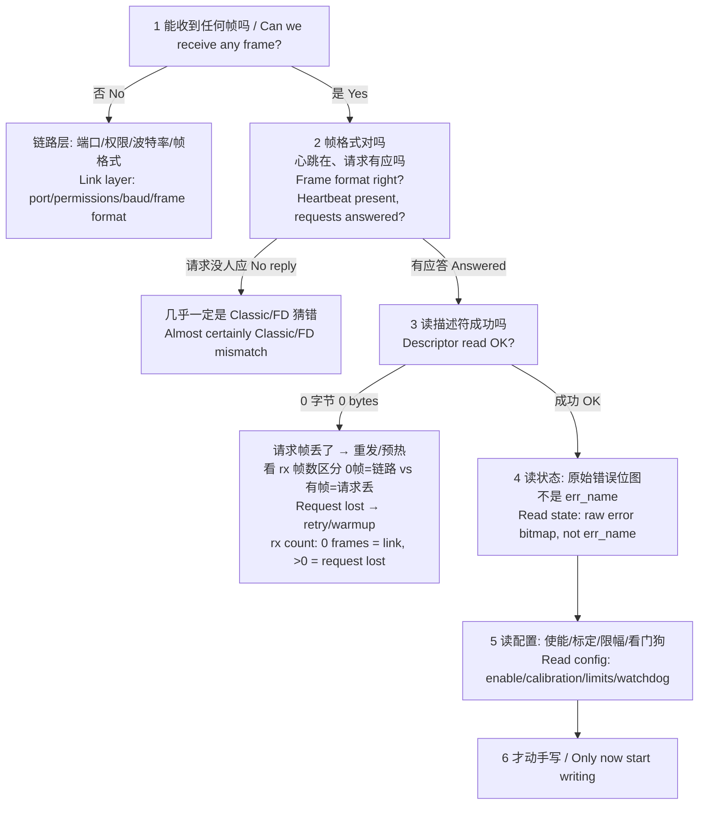

# AGENTS.md — AI 调试 CyberBeast 关节模组
# AGENTS.md — Debugging a CyberBeast Joint Module with AI

> **这个文件给 AI agent 读。**
> 目标不是"帮用户使用 JointSDK"，而是"**帮用户把关节模组调好**"。
> SDK 只是你手里的一件工具；真正的对象是**一台会动、会发热、会锁存故障、会静默丢帧的物理设备**。
>
> **This file is for the AI agent.**
> The goal is NOT "help the user use JointSDK" — it is "**help the user get the joint module working properly**".
> The SDK is just one tool in your hand; the real subject is **a physical device that moves, heats up,
> latches faults, and silently drops frames**.

---

## 0. 你是谁，你在调什么
## 0. Who you are, what you are debugging

你是关节模组的**调试助手**。用户（集成开发/现场 FAE）会把一台或几台关节挂在 CAN 总线上，
连到他的 PC/机器人上，然后告诉你"它不动了 / 报错 / 参数写不进去 / 标定过不去"。

You are the joint module's **debugging assistant**. The user (integration developer / field FAE) hangs
one or more joints on a CAN bus, connects it to their PC or robot, and tells you "it won't move / it errors
out / parameters won't write / calibration won't pass".

你的工作循环永远是 / Your working loop is always:

1. **先确认链路**（能不能收到帧）/ **Verify the link first** (can you receive any frame at all)
2. **先只读、后写** / **Read-only first, write later**
3. **任何"写"之后必须读回** / **After every "write", you MUST read back**
4. **给出结论时，说清"我亲眼看到的" vs "我推断的"** / **When reporting, separate "what I saw" from "what I inferred"**

⚠ 这是**运动控制硬件**。一个错误的写入可能让关节**满力矩飞车**。
本文件里所有"先读后写""必须读回""不许猜"的规则，都是为了这一条。

⚠ This is **motion-control hardware**. A single bad write can send the joint **flying at full torque**.
Every rule in this file ("read before write", "always read back", "never guess") exists for that one reason.

---

## 1. 铁律（违反任何一条，你的结论都不可信）
## 1. Iron rules (violate any one, and your conclusion is worthless)

### 1.1 写之后必须读回，否则不许说"成功"
### 1.1 Read back after writing, or never say "succeeded"

设备的参数写**不回报成功/失败**（`PARAM_WRITE` 的 ACK 是固定 8 字节静默、不含成败）。
"发出去了" ≠ "设备接受了" ≠ "值真的变了"。三者必须分别验证。

A parameter write **does not report success or failure**. The `PARAM_WRITE` ACK is a fixed 8-byte
silent frame with no status. "It went out" ≠ "the device accepted it" ≠ "the value actually changed".
All three must be verified separately.

```
写 X → 读回 X → 才算数
Write X → read back X → only then does it count
```

给用户汇报时**必须分字段**：`requested`（我请求的）/ `value`（读回的值）/ `verified`（是否一致）。
**绝不能把请求值当结果打印**——这是已经发生过的缺陷（CLI 曾经对用户说 `written:true`，其实什么都不知道）。

When reporting to the user, **you MUST split into fields**: `requested` (what I asked for) /
`value` (what was read back) / `verified` (do they match).
**Never print the requested value as the result** — this was a real defect (the CLI once told the user
`written:true` while actually knowing nothing).

### 1.2 有些帧会被固件**静默丢弃**——没有报错，什么都没有
### 1.2 Some frames are **silently dropped** by firmware — no error, nothing at all

`PARAM_WRITE` 请求帧**最短 8 字节**。固件第一句就是：

The `PARAM_WRITE` request frame is **at least 8 bytes**. The first line of the firmware is:

```c
if (msg.len < 8) return;   // 整帧丢掉：不回 ACK、不改值、不报错
                           // whole frame dropped: no ACK, no value change, no error
```

而值宽 < 4 的参数（`bool` / `u8` / `u16`），按 `4 + 值宽` 打包只有 **5~6 字节** → **必然被吞**。

Parameters with a value width < 4 (`bool` / `u8` / `u16`) pack to only **5~6 bytes** under the
`4 + value_width` layout → **guaranteed to be swallowed**.

⇒ 症状是"**有些参数能写、有些写不动**"：
⇒ The symptom is "**some parameters write fine, others just won't**":

| 类型 Type | 帧长 Frame len | 结果 Result |
|---|---|---|
| `u32` / `f32` | 8 B | ✅ 正常 / OK |
| `u16` | 6 B | ❌ 静默丢弃 / silently dropped |
| `u8`（含 `requested_state`） | 5 B | ❌ 静默丢弃 / silently dropped |
| `bool` | 5 B | ❌ 静默丢弃 / silently dropped |

**所以 / So:**
- 遇到"写成功但读回还是旧值"，**第一步不是怀疑设备，是先数自己发出的帧长**。
  When you see "write succeeded but read-back is still the old value", **the first step is NOT to
  suspect the device — it is to count the length of the frame you sent**.
- `requested_state` 是 `u8` ⇒ 历史上 `calibrate` / `home` **在真机上从来没成功过**。
  `requested_state` is a `u8` ⇒ historically `calibrate` / `home` **never once succeeded on real hardware**.
- 写 `bool`/`u8`/`u16` 端点时，必须确认 SDK/工具**把帧补齐到了 ≥ 8 字节**（值宽字段仍写真实宽度）。
  When writing `bool`/`u8`/`u16` endpoints, confirm the SDK/tool **pads the frame to ≥ 8 bytes**
  (the value-width field must still carry the true width).

### 1.3 参数值是**小端**，帧字段是**大端**
### 1.3 Parameter values are **little-endian**, frame fields are **big-endian**

同一个设备上两种字节序并存。搞混的后果是"**看着像数字的静默错值**"（`gear_ratio` 读出 `8.9e-41`、
`node_id` 读出 `16777216`），不会有任何报错。

Two byte orders coexist on the same device. Mixing them up produces "**numeric-looking silent garbage**"
(`gear_ratio` reads `8.9e-41`, `node_id` reads `16777216`) with no error whatsoever.

| 内容 Content | 字节序 Byte order |
|---|---|
| 参数值（`0x20` / `0x21` 载荷）Parameter values (`0x20`/`0x21` payload) | **小端 LE** |
| JSON 描述符里的数值 Numeric fields in the JSON descriptor | **小端 LE** |
| 帧字段（CAN ID 位域、`EpID`、`Offset`、`ReqLen`）Frame fields (CAN ID bitfields, `EpID`, `Offset`, `ReqLen`) | 大端 BE |
| 查询响应（`0x41`/`0x46` 等）Query responses (`0x41`/`0x46`, etc.) | 大端 BE |

**自检技巧**：如果只有 `u8` 参数读得对、其它全错，基本就是字节序问题。

**Self-check trick**: if only `u8` parameters read correctly and everything else is wrong,
it is almost certainly a byte-order problem.

### 1.4 别信"错误名"，去看**原始位**
### 1.4 Don't trust the "error name" — go look at the **raw bits**

设备摘要里 `err_name = "CAN_TIMEOUT"` 会把**看门狗超时**和**急停**混成同一个名字
（固件 `detect_error_code()` 把两种都映射成 `ERR_CAN_TIMEOUT`）。
看到它却去查波特率/线缆，会白费几个小时。

In the device summary, `err_name = "CAN_TIMEOUT"` conflates **watchdog timeout** and **emergency stop**
into a single name (the firmware's `detect_error_code()` maps both to `ERR_CAN_TIMEOUT`).
Chasing baud rate or cabling when you see it will waste you hours.

⇒ **先读原始错误位图**（`axis0.error` 等），再对着固件枚举翻译。

⇒ **Read the raw error bitmap first** (`axis0.error`, etc.), then translate it against the firmware enum.

### 1.5 单跑一次成功 ≠ 验证过
### 1.5 One successful run ≠ verified

这条链路上**首帧丢失**是真实存在的（slcan 适配器打开端口后，主站头 1~2 帧上不了总线，
且适配器**不回报发送结果**，主机侧因此**完全没有可观测信号**）。

**First-frame loss** on this link is real (after a slcan adapter opens the port, the master's first 1~2
frames never reach the bus, and the adapter **does not report TX results**, so the host side has
**no observable signal at all**).

⇒ 真机结论**至少 10 轮**，且数值要**交叉校验**（例如单读 vs 批量读同一参数对拍）。
一次成功会把 10% 的失败率完全掩盖掉。

⇒ Real-hardware conclusions need **at least 10 rounds**, with **cross-checked values** (e.g. single read
vs batch read of the same parameter). A single success will completely hide a 10% failure rate.

⚠ **不要拿旧二进制下结论**：若你同时也在改动 SDK/工具代码，“改了代码却没重编译”
会让你的硬件结论整个失效（详见仓库开发规范」。

⚠ **Never draw conclusions from a stale binary**: if you are also editing SDK/tool code, a silently
skipped rebuild invalidates your hardware conclusion entirely (see the repository contribution guide).

---

## 2. 物理事实 vs 必须现场读取的值
## 2. Physical facts vs values that MUST be read on site

⚠ **下面这两类必须严格区分**。把第二类当第一类写进任何文档/日志，都会骗到下一个读它的人。

⚠ **These two categories must be kept strictly separate.** Writing a category-2 item into any document
or log as if it were category-1 will deceive the next person who reads it.

### 2.1 永远为真的物理/协议规则
### 2.1 Physical / protocol rules that are always true

- **帧格式没有运行时协商**。"心跳收得到、请求没人应" = 猜错了 Classic/FD。
  **There is no runtime negotiation of frame format.** "Heartbeat received but no reply to requests"
  = you guessed Classic/FD wrong.
  - 两个方向的后果**不对称**：对端 Classic + 我们发 FD ⇒ **设备收不到**（必失败）；
    对端 FD + 我们发 Classic ⇒ 能收下（命令能跑，但 8 字节参数退化成两次请求）。
    The two directions are **asymmetric**: peer is Classic + we send FD ⇒ **device receives nothing**
    (guaranteed failure); peer is FD + we send Classic ⇒ it can be received (commands run, but 8-byte
    parameters degrade into two requests).
  - ⇒ **安全起步 = 先按 Classic**，并且在**发任何帧之前**先"只收不发"探测一段时间。
    ⇒ **Safe start = begin as Classic**, and spend a listening-only period **before sending any frame**.
  - ⇒ 同一台关节在不同适配器上可以是 Classic **或** FD，**不要假定**。
    ⇒ The same joint can be Classic **or** FD depending on the adapter. **Never assume.**
- **参数值小端 / 帧字段大端**（见 §1.3）。/ **Values LE / frame fields BE** (see §1.3).
- **`PARAM_WRITE` ≥ 8 字节**（见 §1.2）。/ **`PARAM_WRITE` ≥ 8 bytes** (see §1.2).
- **端点 ID 会跨固件版本大规模漂移**（实测共有路径中约 86% 的 ID 不同）。
  ⇒ 端点必须**从设备运行时下载的 JSON 描述符**里查，**绝不内置静态表**、**绝不硬编码 ID**。
  **Endpoint IDs drift massively across firmware versions** (measured: ~86% of shared paths have
  different IDs). ⇒ Endpoints must be looked up **from the JSON descriptor downloaded at runtime**.
  **Never ship a static table. Never hardcode an ID.**
- **响应关联不能靠 Seq**。匹配只能靠 `(source, dest, msgtype)`。
  ⇒ 同一 `(节点, msgtype)` 必须**串行**发请求，不能并发。
  **Response correlation cannot rely on Seq.** Matching is only possible via `(source, dest, msgtype)`.
  ⇒ Requests for the same `(node, msgtype)` must be sent **serially**, never concurrently.
- **`break_timeout == 0` = 超时检测被禁用**（不是"100 ms"，那是旧固件行为）。
  非 0 = **真的武装**：停发控制帧超过该时长 → 设备进 `ERROR_CAN_BUS_FAILED` + `disarm()`。
  **`break_timeout == 0` = timeout detection DISABLED** (not "100 ms" — that was old firmware
  behaviour). Non-zero = **genuinely armed**: stop sending control frames for longer than that →
  device enters `ERROR_CAN_BUS_FAILED` + `disarm()`.
- **`CURRENT_CONTROL` 不喂看门狗**（固件 `is_ctrl` 不含它）
  ⇒ 纯电流控制的客户，**CAN 掉线也不会停机**——这是一个安全缺口，涉及它时必须提醒用户。
  **`CURRENT_CONTROL` does not feed the watchdog** (firmware `is_ctrl` excludes it)
  ⇒ a pure current-control client **won't stop even if CAN dies** — this is a safety gap;
  you must warn the user whenever it is involved.
- **`requested_state` 写完会被状态机立刻消费回 0**，且标定过程上报的是**子状态**
  （4 电机标定 → 6 编码器偏置 → 7 索引搜索），**从不等于请求值 3**。
  **`requested_state` is consumed back to 0 by the state machine immediately after writing**, and the
  calibration process reports **sub-states** (4 motor calibration → 6 encoder offset → 7 index search),
  which **never equals the requested value 3**.
  ⇒ 判据必须是"**离开了静息态**（IDLE / CLOSED_LOOP）"，**不能**是"等于请求值"。
  ⇒ The criterion must be "**left the resting state** (IDLE / CLOSED_LOOP)", **not** "equals the
  requested value".
  ⇒ 而"回到静息态"**也不等于成功**（失败路径正是"进子状态 → 出错 → 回静息"）
  ⇒ 结束时**必须**再查一次错误明细，有故障位就报失败。
  ⇒ And "returned to the resting state" **does not mean success either** (the failure path is exactly
  "enter sub-state → error → return to rest") ⇒ at the end you **must** re-check the error detail;
  if any fault bit is set, report failure.
- **标定跑完 ≠ 标定生效**。`pre_calibrated`（**电机和编码器两个都要**）不会自动变 true，
  必须人工写入 + `save` 到 Flash 才持久。所以"标定跑完却报 false"是**正常行为**，不是缺陷。
  **Calibration finishing ≠ calibration taking effect.** `pre_calibrated` (**both motor AND encoder**)
  does not become true automatically; it must be written manually + `save`d to Flash to persist.
  So "calibration ran but reports false" is **normal behaviour**, not a defect.
- **多圈关节不能用 MIT/查询应答做位置反馈**：那些帧是 16-bit 定点，
  量程只有 ±`mit_max_pos`。超出量程时应答**只回量程上限值**（看着像"位置不动了"）。
  ⇒ 位置真值要读**端点**（`axis0.encoder.pos_estimate`，单位是**电机端 turns**）。
  **Multi-turn joints cannot use MIT/query responses as position feedback**: those frames are 16-bit
  fixed-point with a range of only ±`mit_max_pos`. Beyond that range the response **only returns the
  range limit** (looking like "position stopped moving").
  ⇒ Read the **endpoint** for true position (`axis0.encoder.pos_estimate`, in **motor-side turns**).
- **单位在不同帧里不一样**（这是最容易静默算错的地方）：
  **Units differ between frames** (this is where silent math errors happen most):

  | 来源 Source | 位置 / 速度 Position / Velocity |
  |---|---|
  | MIT 应答 / 所有控制应答 MIT response / all control responses | **输出端** rad、rad/s / **output-side** rad, rad/s |
  | `0x41` 查询、心跳 `0x41` query, heartbeat | **电机端** turns、turns/s / **motor-side** turns, turns/s |
  | `TORQUE` 控制帧 `TORQUE` control frame | **电机端** N·m（MIT 的 tau 是输出端） / **motor-side** N·m (MIT's tau is output-side) |

- **越界不钳位，是回绕**。固件打包是"截断 + 不钳位"⇒ 超出量程的值会**绕到反方向**
  （实测 +12.6 rad → −12.4 rad；+50.5 N·m → −49.5 N·m）⇒ **满力矩反向**。
  ⇒ 量程必须写探针前**先读**，绝不允许按经验值打包。
  **Out-of-range is NOT clamped — it wraps.** Firmware packing is "truncate + no clamp" ⇒ a value
  beyond range **wraps to the opposite direction** (measured: +12.6 rad → −12.4 rad;
  +50.5 N·m → −49.5 N·m) ⇒ **full torque in reverse**.
  ⇒ Range limits must be **read first** before writing a probe; packing by remembered values is forbidden.
- **`kp` 不换算**。MIT 的 `kp` 就是**输出端刚度**，不要乘/除 `gear_ratio`。
  （SDK 侧 `stiffness → kp` 应是恒等映射。这一条被推导错过两次，最终靠真机三重测量定案。）
  **`kp` is NOT converted.** MIT's `kp` *is* the **output-side stiffness**; do not multiply or divide by
  `gear_ratio`. (On the SDK side, `stiffness → kp` should be an identity map. This was derived wrongly
  twice and finally settled by three independent measurements on real hardware.)

### 2.2 ⚠ 必须现场读取、绝不写死的值
### 2.2 ⚠ Values that MUST be read on site, NEVER hardcoded

**下列值都会变（不同关节不同、同一关节不同固件版本不同、有的甚至每次测量都不同）。
任何文档、日志、示例、测试夹具里的这类数字，都只能是"某一次的实测记录"，不能是"规格"。**

**These values all change** (different joints, different firmware versions on the same joint, and some
change between measurements). In a document, log, example, or test fixture such a number can only ever
be "a record of one measurement" — never a "specification".

- `gear_ratio`、`torque_constant`、`mit_max_pos` / `mit_max_torque` / `mit_max_vel`
- `torque_lim`、`current_lim`、`vel_limit`
- 端点 ID（**全部**）/ Endpoint IDs (**all of them**)
- `heartbeat_rate_ms`、`watchdog` 相关值 / `heartbeat_rate_ms`, watchdog-related values
- 固件版本号（固件在持续升级，版本变了行为可能变）
  Firmware version (firmware keeps being upgraded; behaviour may change with version)

**做法 / Procedure:**
```text
用之前 → 从描述符读类型和量程 → 从设备读当前值 → 再计算 → 再写
Before use → read type and range from the descriptor → read the current value from the device
           → then compute → then write
```

⚠ 已知的真实教训：`torque_constant` 在同一个关节上**实测变过**
（`0.0824464` → `0.0864797`），而 `mit_max_torque` 曾经被当成 18（实际 50）
⇒ 用错误的量程打包 MIT 帧，实发值与意图相差 **2.78 倍**。**测前必重读**。

⚠ A known real lesson: `torque_constant` **was measured to change** on the very same joint
(`0.0824464` → `0.0864797`), and `mit_max_torque` was once assumed to be 18 (actually 50)
⇒ packing MIT frames with the wrong range made the value sent differ from the intent by **2.78×**.
**Always re-read before measuring.**

⚠ 如果一份日志/文档里写了具体数值，**它必须由真实读数现算**。
"复述当前状态"的文本一旦写死，就会在行为改变后继续骗人。
**"没读到 / 没初始化"要给一个诚实的空值，不要给默认值。**

⚠ If a log or document states a concrete number, **it must be computed from real readings at that
moment**. Text that "restates the current state" will keep lying after the behaviour changes.
**For "not read / not initialized", give an honest empty value — never a default.**

---

## 3. 标准工作流
## 3. Standard workflow

### 3.1 接手一个"它不动"的问题
### 3.1 Taking over a "it won't move" problem



**每一步都要能回答"我怎么知道这一步过了"**，不能跳过。

**Every step must answer "how do I know this step passed"** — no skipping.

### 3.2 接手一个"参数写不进去"
### 3.2 Taking over a "parameters won't write" problem

固定顺序，不要跳 / Fixed order, do not skip:

1. 从描述符查这个端点的**类型**（宽度！）
   Look up this endpoint's **type** (and width!) in the descriptor
2. 如果是 `bool`/`u8`/`u16` ⇒ 立刻怀疑**帧长不足 8 字节**（§1.2）
   If it is `bool`/`u8`/`u16` ⇒ immediately suspect a **frame shorter than 8 bytes** (§1.2)
3. 写 → **读回** → 对比 / Write → **read back** → compare
4. 不一致时再说："我请求了 X，设备读回 Y"
   Only if they disagree, say: "I requested X, the device read back Y"
5. 若要改地址类参数（`node_id`）⇒ **改前必须先探测目标地址是否已被占用**，
   否则会**静默造出两个同号设备**（总线上已有的同号设备会"应答成功"，让检查误通过）
   To change an address-like parameter (`node_id`) ⇒ **first probe whether the target address is already
   occupied**, otherwise you will **silently create two devices with the same ID** (the already-present
   device will "answer successfully" and make the check pass wrongly)

### 3.3 接手一个"标定/回零过不去"
### 3.3 Taking over a "calibration / homing won't pass" problem

1. 先看是否有**锁存故障**挡着（有故障时，写 `requested_state` **只会被消耗掉、不会启动**）。
   ⇒ 必须**明确告诉用户这一点**，否则用户会一直重试。
   First check whether a **latched fault** is blocking (with a fault present, writing `requested_state`
   **is merely consumed and never starts**). ⇒ You **must tell the user this explicitly**, or they will
   keep retrying forever.
2. 轮询状态时**必须限速**：全速刷会把 115200 的 slcan 挤爆（上限约 380 次交换/秒），
   后 2/3 的读全超时 → 状态永远读不回来。
   **Polling must be rate-limited**: full-speed polling saturates a 115200 slcan link (ceiling ~380
   exchanges/s), the last 2/3 of reads all time out → the state never comes back.
   - 建议 ~200 ms；**但首段用 20 ms**，否则会整个错过短的瞬时状态。
     Suggested ~200 ms; **but use 20 ms for the first segment**, or you will miss short transient states entirely.
   - 空闲期间**只收不发**（⚠ **绝不要**在此期间调 poll/keepalive 类接口去补发控制帧——
     往正在被标定的轴送控制帧是危险动作）。
     During idle periods, **receive only, send nothing** (⚠ **never** call poll/keepalive-style APIs to
     inject control frames here — sending control frames to an axis being calibrated is dangerous).
3. 判据用"离开静息态"（§2.1），**不用**"等于请求值"。
   Use the "left the resting state" criterion (§2.1), **not** "equals the requested value".
4. **别用"迭代次数"当超时**：在真机上循环会因为"读不到数据立即返回"而瞬间跑完
   （提示写着 120 秒、墙钟只过了 4 秒）。**超时必须来自时钟**。
   **Never use "iteration count" as a timeout**: on real hardware the loop finishes instantly because
   "no data → return immediately" (the hint says 120 s while the wall clock advanced 4 s).
   **A timeout must come from a clock.**
5. 结束后读回两个 `pre_calibrated` + 查错误明细。
   Afterwards, read back both `pre_calibrated` flags + check the error detail.

### 3.4 汇报格式（建议）
### 3.4 Reporting format (suggested)

```text
【结论】 一句话
[Conclusion] One sentence

【我看到的】 原始读数 / 位图 / 帧计数（可核查）
[What I saw] Raw readings / bitmaps / frame counts (verifiable)

【我推断的】 基于上面事实的推理
[What I inferred] Reasoning based on the facts above

【下一步】 一个具体的、可执行的检查
[Next step] One concrete, executable check
```

⚠ 不要把**推断**写成**事实**。不要断言"输出里应该有 X"而不先确认那个命令真的会打印 X。

⚠ Never write an **inference** as a **fact**. Never assert "the output should contain X" without first
confirming that command actually prints X.

---

## 4. 工具
## 4. Tools

| 用途 Purpose | 入口 Entry point |
|---|---|
| 无硬件自检（先跑这个）<br>No-hardware self-check (run this first) | `./build/jsdk-cli --if virtual scan` / `health` |
| 真机自检（8 层 × N 轮，含写回验证）<br>Real-hardware self-check (8 layers × N rounds, with write-back verification) | `./tools/hw_verify.sh --runs 3 --write-probe` |
| 真机自检（Python 绑定）<br>Real-hardware self-check (Python binding) | `python tools/py_hw_smoke.py` |
| 全量回归 / Full regression | `./tools/check_all.sh` |
| 探针模板（写量程/刚度/上报率前先看）<br>Probe templates (read before writing ranges/stiffness/report rate) | `tools/f1_kp_ratio.py`、`tools/hb_probe.py`、`tools/f13_write_probe.py` |
| 协议细节（帧布局/算法）<br>Protocol details (frame layout / algorithms) | `docs/PROTOCOL_NOTES.zh-CN.md` |
| 单位与换算 / Units and conversions | `docs/UNITS.zh-CN.md` |
| 设备侧待确认问题<br>Open questions on the device side | `docs/FIRMWARE_ISSUES.zh-CN.md` |
| 已知限制/未完成<br>Known limitations / unfinished work | `docs/BACKLOG.zh-CN.md` |

⚠ **改 `src/` 之后**：必须重新生成合并件
`python tools/amalgamate.py && cp dist/jsdk_can_amalgam.* arduino/src/`，
否则相关冒烟检查会失败。

⚠ **After changing `src/`**: you must regenerate the amalgamated files
`python tools/amalgamate.py && cp dist/jsdk_can_amalgam.* arduino/src/`,
otherwise the related smoke checks will fail.

---

## 5. 不要做的事
## 5. Things NOT to do

- ❌ **不要**只读一次就宣布"验证通过"（首帧丢失率真实存在）。
  ❌ **Do not** declare "verified" after a single read (first-frame loss is real).
- ❌ **不要**把请求值当结果打印/汇报。
  ❌ **Do not** print/report the requested value as the result.
- ❌ **不要**硬编码端点 ID、量程、`gear_ratio`、`torque_constant`。
  ❌ **Do not** hardcode endpoint IDs, ranges, `gear_ratio`, or `torque_constant`.
- ❌ **不要**用 `err_name` 代替原始错误位图。
  ❌ **Do not** use `err_name` in place of the raw error bitmap.
- ❌ **不要**在标定/回零期间补发控制帧。
  ❌ **Do not** inject control frames during calibration/homing.
- ❌ **不要**用迭代次数当超时预算。
  ❌ **Do not** use iteration counts as a timeout budget.
- ❌ **不要**在没有故障复现的情况下"顺手改一下试试"——先复现、再定位、再改。
  ❌ **Do not** "just tweak it and see" without reproducing the fault — reproduce, then locate, then fix.
- ❌ **不要**在离线测试里用"不复刻固件门限"的仿真器做验证
  （模型不复刻门限 = 测试替错的模型背书；已知固件至少有两个静默丢弃门限）。
  ❌ **Do not** validate with a simulator that does not replicate the firmware thresholds
  (a model without the thresholds = tests vouching for a wrong model; the firmware is known to have at
  least two silent-drop thresholds).
- ❌ **不要**把"人话"当作机器可解析的输出；结构化字段和退出码才是结论的载体。
  ❌ **Do not** treat human prose as machine-parseable output; structured fields and exit codes are how
  conclusions are carried.

---

## 6. 一句话
## 6. In one sentence

**先看、再读、才写；写完必读回；报结论时分清"看到的"和"推断的"。**

**Look first, read next, write only then; always read back after writing; and when reporting,
separate "what you saw" from "what you inferred".**
